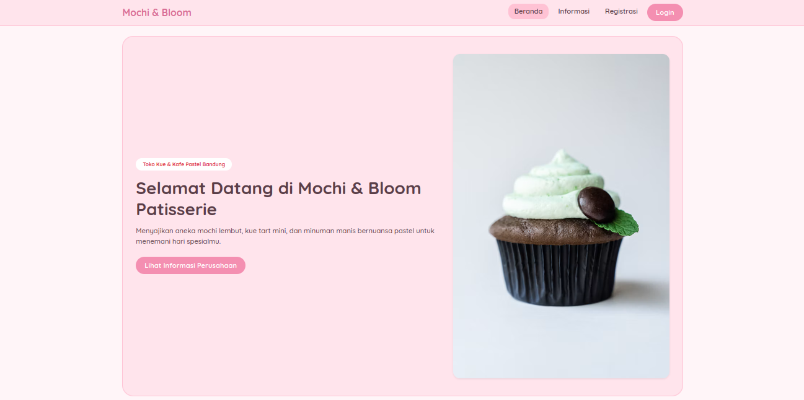
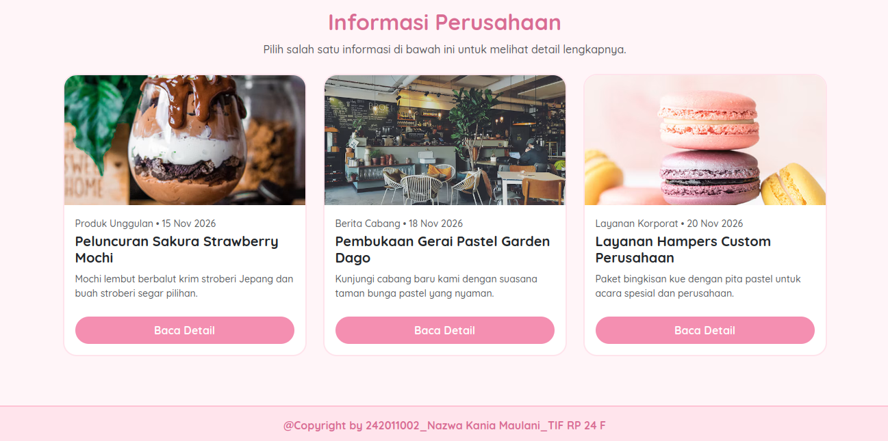
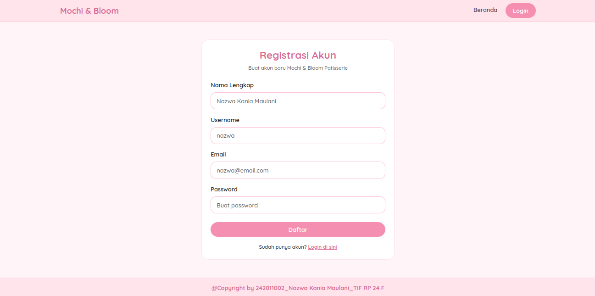
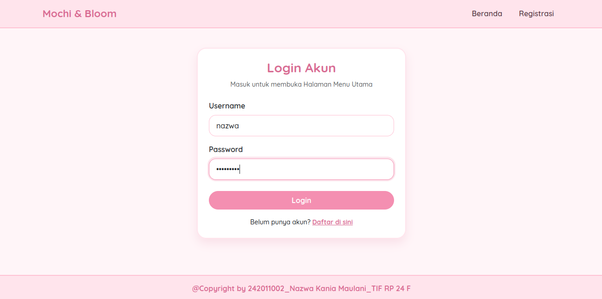

# Project 1 — Website Informasi Perusahaan (Mochi & Bloom Patisserie)

- **Nama:** Nazwa Kania Maulani
- **NPM:** 242011002
- **Kelas:** TIF RP 24 F
- **Mata Kuliah:** Pemrograman Web 1

## Deskripsi
Website profil dan informasi perusahaan **Mochi & Bloom Patisserie** yang dibangun menggunakan HTML Semantik, CSS3, Bootstrap 5, dan JavaScript dasar dengan tema desain *pink pastel*.

## Screenshot Hasil Tampilan

### 1. Halaman Utama (`index.html`)

### 2. Halaman Detail Informasi (`detail.html`)

### 3. Halaman Registrasi (`register.html`)

### 4. Halaman Login (`login.html`)

### 5. Halaman Menu Utama (`dashboard.html`)
