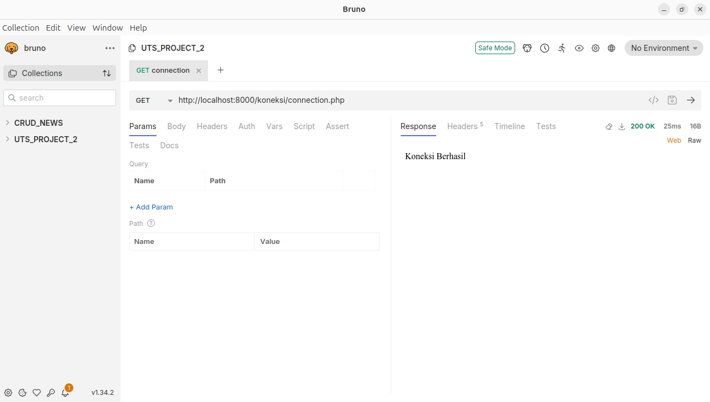
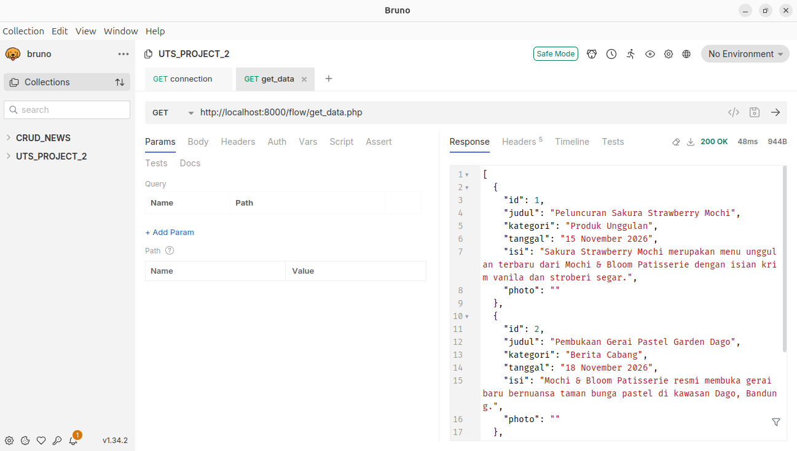
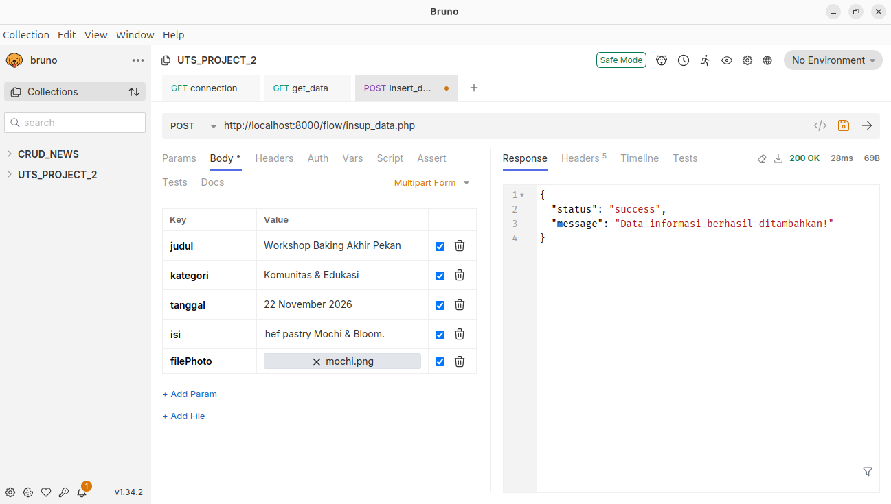
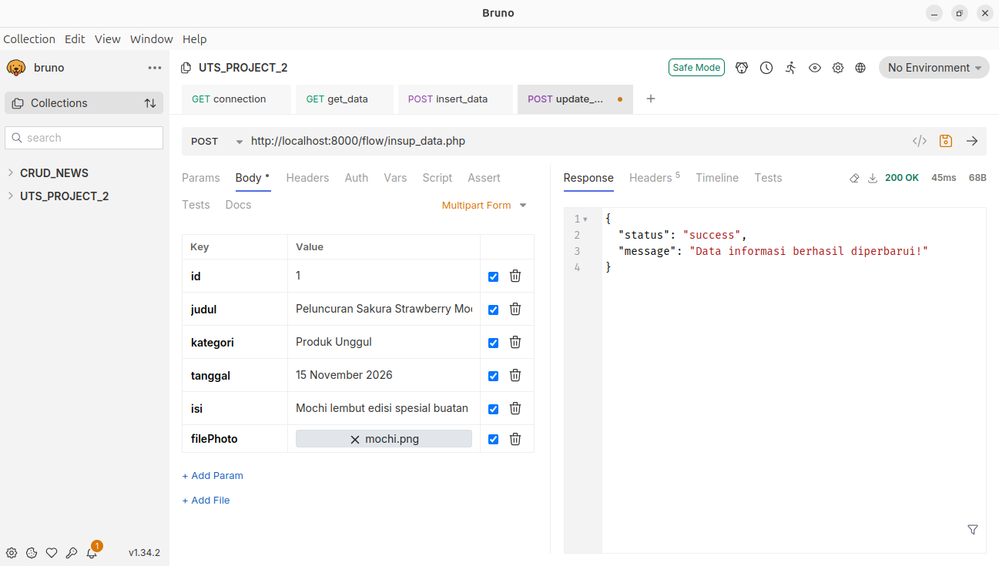
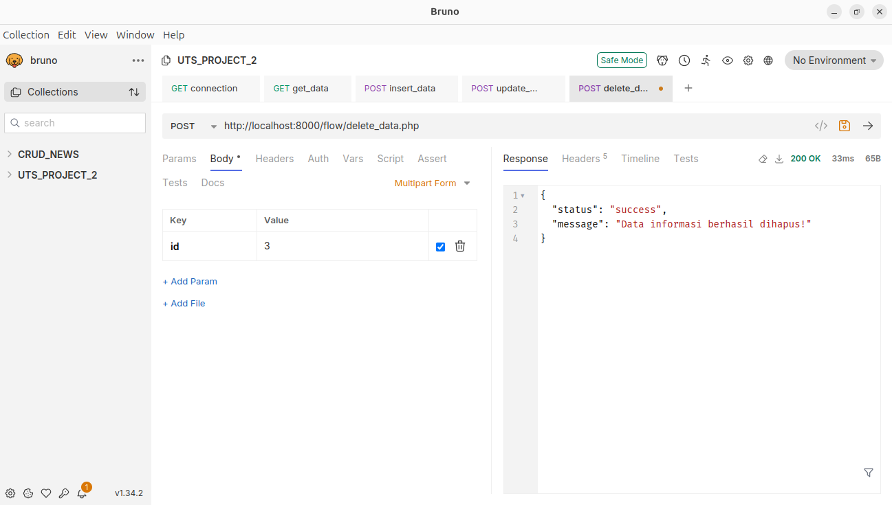

# Project 2 — REST CRUD API Informasi Perusahaan

- **Nama:** Nazwa Kania Maulani
- **NPM:** 242011002
- **Kelas:** TIF RP 24 F
- **Mata Kuliah:** Pemrograman Web 1

## Deskripsi
Backend REST CRUD API menggunakan **PHP (PDO) dan MySQL** yang mengelola data tabel `informasi_perusahaan` sesuai dengan data pada Project 1.

## Screenshot Hasil Uji API (Bruno)

### 1. Uji Koneksi Database (`GET connection.php`)

### 2. Uji Ambil Data (`GET get_data.php`)

### 3. Uji Tambah Data (`POST insup_data.php` - Insert)

### 4. Uji Ubah Data (`POST insup_data.php` - Update)

### 5. Uji Hapus Data (`POST delete_data.php`)
